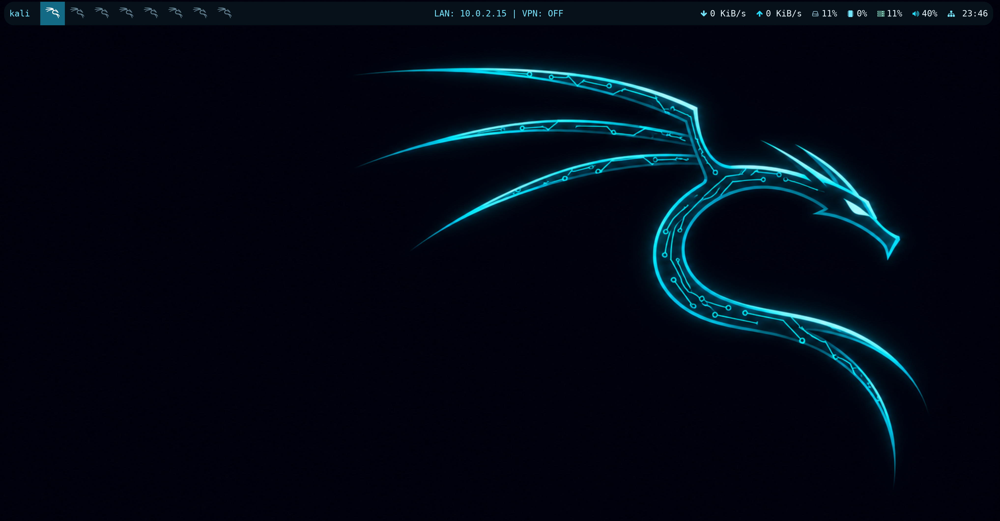
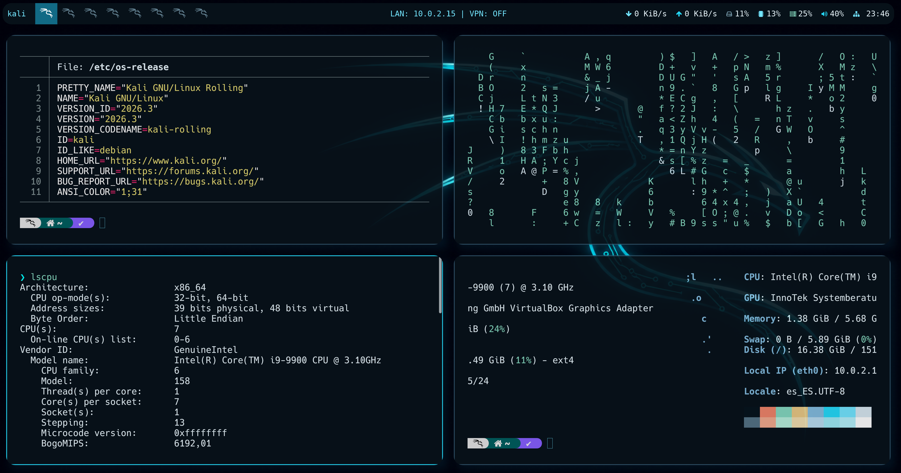
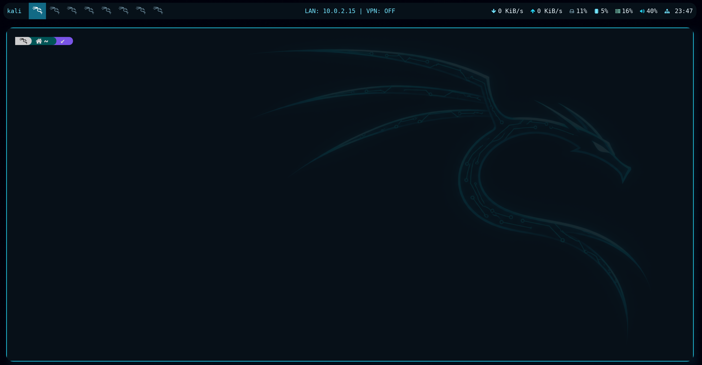

# Kali-Bspwm-Ice

Un escritorio **bspwm para Kali Linux** con dragones en los escritorios, negro,
azul hielo y cian, ventanas redondeadas y escalado independiente de la resolución.
Basado en la configuración de **[r1vs3c/auto-bspwm](https://github.com/r1vs3c/auto-bspwm)**,
con sus atajos de bspwm, Kitty y Zsh conservados.

Personalización mantenida por **[W4lterSec](https://github.com/W4lterSec)**.

## Videotutorial

Pulsa el botón de reproducción para ver el tutorial aquí mismo.
Versión para web · 3:55 · instalación desde Git y demostración del escritorio.

https://github.com/user-attachments/assets/f9e13e85-31d5-4f1e-939e-5c031bb5fd3b

## Capturas del escritorio

### Escritorio y barra Polybar



### Terminales en mosaico



### Transparencia y bordes



Capturas reales de Kali Linux 2026.3 en VirtualBox. Abre una imagen para verla
a su resolución original. La [guía de instalación](TUTORIAL-INSTALACION.md)
acompaña el videotutorial.

## Estado

Configuración probada por su mantenedor en Kali Linux dentro de VirtualBox:
ocho dragones centrados, ventanas estables y transparencia suave. El vídeo
y las capturas anteriores muestran la instalación real.

Glass utiliza un 90 % de opacidad uniforme mediante Picom. Kitty conserva su
fondo nativo opaco para evitar el error de transparencia observado en la VM.
Este efecto atenúa ligeramente el texto junto con el fondo de la ventana.
Solid y Light usan un 100 % de opacidad.

El paquete conserva los directorios internos `kali-dragon-ice` y los atajos de
la base validada. Los ocho escritorios se representan mediante el dragón Kali,
con la fuente Hack Nerd Font Propo y márgenes simétricos. Los atajos 9 y 0 se
conservan en el archivo original, aunque esta edición tiene ocho escritorios.

## Qué incluye

- Ocho dragones Kali centrados con fuente Propo y espacio simétrico.
- IP local y del túnel VPN, con actualización cada tres segundos.
- Descarga/subida, disco, CPU, RAM, volumen, estado de red y hora a la derecha.
- Cuatro fondos Cyberpunk con rotación cada diez minutos.
- Ventanas con separación, esquinas redondeadas y sombras suaves.
- Estilos **Glass**, **Solid** y **Light**.
- Escala automática y perfiles 100 %, 125 %, 150 % y 200 %.
- Configuración recuperable y registro de paquetes añadidos.

## Requisitos

Kali Linux con sesión **X11**, acceso a APT y a los repositorios oficiales de
Oh My Zsh y Powerlevel10k. Ejecuta el instalador como usuario normal con sudo.
No se añaden repositorios APT. El paquete incluye los fondos y las fuentes.
Las aplicaciones de los atajos, incluidas Firefox ESR y Burp Suite, se instalan
desde Kali si faltan; pueden requerir una descarga grande.

En VirtualBox conviene crear una instantánea antes de instalar. Las Guest
Additions se incluyen como dependencia cuando se detecta VirtualBox.

## Instalar

[Guía paso a paso para la instalación y el tutorial](TUTORIAL-INSTALACION.md).

Desde una sesión **Xfce**, descarga el proyecto y ejecuta el instalador como
usuario normal:

```bash
git clone https://github.com/W4lterSec/Kali-Bspwm-Ice.git
cd Kali-Bspwm-Ice
bash install.sh
```

También puedes extraer el ZIP del proyecto, abrir una terminal en su carpeta y
ejecutar `bash install.sh`.

Después cierra sesión y selecciona **bspwm** en la pantalla de acceso.
Una instalación nueva ya muestra dragones; no requiere un parche adicional.
El instalador no modifica la shell de root ni elimina la carpeta descargada.

Para seleccionar el acabado y la escala desde el principio:

```bash
bash install.sh --style glass --scale 200
```

## Acabados de ventana

| Estilo | Ventanas | Uso |
| --- | --- | --- |
| `glass` | Negro azulado al 90 % de opacidad de ventana, esquinas de 20 px y sombras | Transparencia suave |
| `solid` | Fondo opaco, esquinas de 14 px y sombras | Máxima legibilidad |
| `light` | Fondo opaco, bordes rectos y sin sombras | Reducir carga gráfica |

Glass es el acabado predeterminado de esta carpeta. Las medidas se escalan con
el perfil. Para cambiar después de instalar:

```bash
bash personalizar.sh glass auto
bash personalizar.sh solid 150
bash personalizar.sh light 100
```

La barra, las distancias y el compositor se actualizan en la sesión. El cambio de
opacidad lo gestiona Picom y afecta a las ventanas Kitty abiertas; los cambios de
tamaño de texto de Kitty se cargan abriendo una terminal nueva.

## Pantallas 4K

**Este proyecto no fuerza 1920×1080 ni cambia la resolución.** Conserva el modo
del monitor y amplía fuentes, dragones, barra, márgenes y esquinas. El perfil
automático usa 200 % para una pantalla activa de al menos 3000×1600, 125 % para
ciertas pantallas de 1440p y 100 % en resoluciones menores.

Para fijar 200 %:

```bash
bash personalizar.sh glass 200
```

Si VirtualBox sólo ofrece una resolución pequeña, comprueba las Guest Additions
y su ajuste de pantalla. La escala de este tema no crea nuevos modos de vídeo.
Las aplicaciones GTK/Qt externas pueden necesitar su propio escalado.

## Atajos

El archivo **sxhkdrc es idéntico byte por byte** al de la base de r1vs3c utilizada en este proyecto.
Se conservan todas las directivas `map` de Kitty y `bindkey` de Zsh. Las pruebas
comparan los hashes y las listas originales, guardadas en `tests/keymaps.json`.

**Super = tecla Windows.**

| Atajo | Acción |
| --- | --- |
| Super+Enter | Abrir Kitty |
| Super+D | Aplicaciones en Rofi |
| Super+flechas | Cambiar de ventana |
| Super+Shift+flechas | Intercambiar ventanas |
| Super+1…8 | Cambiar de escritorio |
| Super+Shift+1…8 | Enviar ventana a otro escritorio |
| Super+W | Cerrar ventana |
| Super+T / S / F | Mosaico / flotante / pantalla completa |
| Super+M | Alternar monocle |
| Super+Alt+flechas | Redimensionar |
| Super+Shift+F / B | Firefox / Burp Suite |
| Ctrl+Alt+L | Bloquear pantalla |
| Ctrl+Shift+arriba/abajo | Volumen |
| Super+Alt+R / Q | Reiniciar bspwm / cerrar sesión |
| Ctrl+Shift+Enter | División de Kitty |
| Ctrl+flechas | Navegar entre divisiones |
| Ctrl+Shift+T | Pestaña de Kitty |

Los dragones son indicadores de escritorio; no asignan automáticamente aplicaciones.
Las ventanas monocle y a pantalla completa conservan su comportamiento original.

## Indicadores y privacidad

La barra consulta `/proc`, el uso del sistema de archivos y las interfaces
locales. No consulta servicios de IP pública ni envía telemetría.

- **VPN** muestra la IPv4 del túnel conectado dentro de Kali; sin túnel muestra `OFF`.
- **Red cableada** muestra un icono de cable. Sólo una interfaz Wi-Fi real muestra
  calidad de señal; una VM con adaptador virtual Ethernet no simula Wi-Fi.
- **Descarga/subida** se calculan sobre la interfaz LAN seleccionada.
- **Volumen** usa PulseAudio o la compatibilidad PulseAudio de PipeWire.

Para fijar interfaces y otras preferencias, edita:

```text
~/.config/kali-dragon-ice/settings.json
```

`lan_interface` y `vpn_interface` vacíos habilitan detección automática. Usa
`ip -br addr` para consultar los nombres reales. `wallpaper_interval` está en
segundos. Los fondos se guardan en:

```text
~/.local/share/kali-dragon-ice/wallpapers/
```

## Restaurar

Entra primero en **Xfce**. Desde esta carpeta:

```bash
bash uninstall.sh
```

Se restaura la configuración anterior a la instalación más reciente, conservando
los archivos retirados. Los paquetes APT permanecen instalados. El historial de
paquetes y las copias están en `~/.local/state/kali-dragon-ice/`. Para recuperar
exactamente una VM, usa su instantánea anterior.

## Diagnóstico y pruebas

```bash
bash doctor.sh
python3 -m unittest discover -s tests -v
```

Después de entrar en bspwm, comprueba el registro real de compositor X11:

```bash
python3 ~/.local/share/kali-dragon-ice/scripts/check-graphics.py
```

Para dar por validada la sesión, abre tres terminales, cambia el foco entre ellas,
redimensiona, cambia de escritorio y reinicia sesión. Ninguna debe desaparecer.
Glass debe dejar ver ligeramente el fondo; Solid debe ser opaco. Revisa también
fuentes, dragones, audio, IP, escala y el cambio de fondo tras diez minutos.

Los registros de sesión están en `$XDG_RUNTIME_DIR/kali-dragon-ice/`, o en
`~/.cache/kali-dragon-ice/`. Si no hay esquinas redondeadas, comprueba que Picom
se esté ejecutando y que no haya otro compositor activo. Si la carga gráfica es
alta, prueba el perfil `light`.

La integración completa debe probarse en una sesión real de Kali. Las pruebas
automatizadas usan datos simulados para las métricas y un directorio temporal
para la instalación; no sustituyen la prueba del compositor, audio y hardware.

## Desarrollo y contribuciones

Las pruebas verifican los atajos originales, las ocho áreas de trabajo, el ancho
del glifo Kali, el renderizado de los perfiles, la integridad de las imágenes y
la instalación/restauración en un directorio temporal. Puedes ejecutarlas
localmente con el comando indicado en la sección de diagnóstico.

Para informar de un problema, incluye la versión de Kali, la resolución, el
perfil de escala, el estilo y la salida de `bash doctor.sh`. Revisa los datos
personales antes de compartir registros o capturas.

## Origen y licencias

Lee [THIRD_PARTY_NOTICES.md](THIRD_PARTY_NOTICES.md) para conocer el origen de los
archivos. [LICENSE-MIT.txt](LICENSE-MIT.txt) se aplica al código nuevo indicado
en esos créditos; los archivos heredados, las fuentes y las marcas conservan
sus propios derechos y licencias.

## Créditos

- **Juan Rivas (@r1vs3c)**: configuración base y atajos de auto-bspwm.
- **Aditya Shakya (@adi1090x)**: trabajo original de Polybar/Rofi de la base.
- **Oh My Zsh** y **romkatv/Powerlevel10k**: shell y prompt.
- **Hack / Nerd Fonts**: fuentes y glifos; el dragón usa `U+F327`.
- Cuatro fondos generados para esta personalización.
- **W4lterSec**: grabación del tutorial y capturas de la instalación real.

Proyecto independiente; no es una distribución oficial de Kali Linux.
